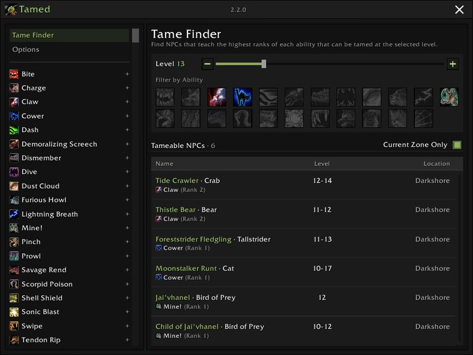
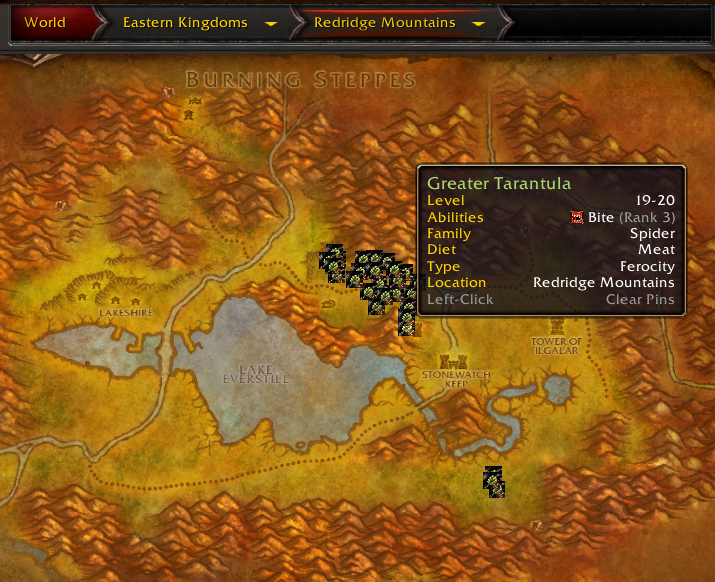

# Tamed

Tamed helps Hunters in Classic WoW find the tameable pets that teach each rank of a pet ability, and shows where they spawn on the world map.

Supports Vanilla, The Burning Crusade, and WoW Forever.




## Features

- **Tame Finder** — lists the NPCs that teach the highest rank of each ability you can tame, at your level or a level you choose. It shows NPCs in every zone or only your current zone, and can be filtered by ability to list only the NPCs that teach all of the abilities you select.
- **Ability ranks** — every pet ability and its ranks, with the pet level, training cost, and families that can learn each rank, and the NPCs that teach it.
- **Map pins** — clicking an NPC opens the world map and pins where it spawns.
- **NPC tooltips** — the abilities an NPC teaches are added to its tooltip. This can be turned off in Options.
- **Minimap icon** — left-click toggles Tamed and right-click clears the map pins. This can be turned off in Options.

## Commands

### Toggle

Toggles the user interface.

```txt
/tamed
```

### Clear Pins

Clears all pins from the map.

```txt
/tamed clear
```

## Contributing

Pet ability and NPC data is hand-editable. See [CONTRIBUTING.md](CONTRIBUTING.md) to add or fix entries.

## Credit

### Libraries

- [CallbackHandler-1.0](https://www.wowace.com/projects/callbackhandler)
- [HereBeDragons-2.0](https://www.wowace.com/projects/herebedragons)
- [LibDataBroker-1.1](https://www.wowace.com/projects/libdatabroker-1-1)
- [LibDBIcon-1.0](https://www.wowace.com/projects/libdbicon-1-0)
- [LibStub](https://www.wowace.com/projects/libstub)
- [Waffle](https://github.com/moody/Waffle)
- [Wux](https://github.com/moody/Wux)

## License

[MIT](LICENSE)
